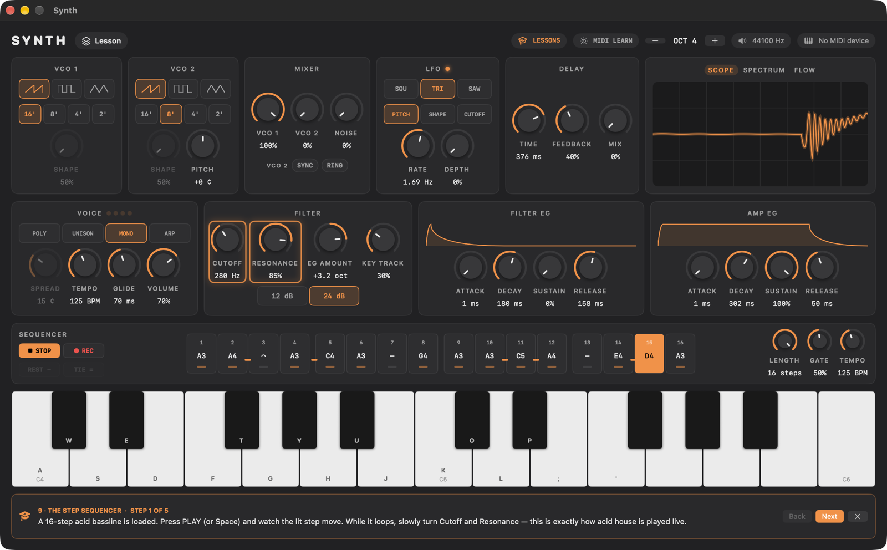

# Synth

A Mac synthesizer for learning how analog synths work. Turn the knobs and watch
what they do to the sound: a live oscilloscope, spectrum analyzer and
signal-flow diagram show it, every control explains itself, and nine
interactive lessons take you from "what's an oscillator?" to programming
acid basslines on the step sequencer.

## Download

**[Download the latest version](https://github.com/geoffalday/synth-releases/releases/latest)**,
open the DMG, and drag Synth to Applications. It's signed and notarized by
Apple.

Requires macOS 15 or later, on Apple silicon or Intel. No special permissions
needed.

## What's inside

- **Sound sources:** two oscillators (saw, square with pulse width, triangle)
  with sync and ring mod, plus noise.
- **Filter:** a resonant 12 or 24 dB filter with its own envelope.
- **Amp:** an amp envelope.
- **Modulation:** an LFO for vibrato, wah or PWM.
- **Voices:** 4-voice poly, unison, mono with glide, and an arpeggiator.
- **Effects:** a stereo, tape-like delay.
- **Step sequencer:** 16 steps with chords, ties and slides.
- **Presets:** factory presets, and you can save your own.

## Playing

Play with your computer keyboard, the on-screen piano or any USB MIDI keyboard.

| | |
|---|---|
| Play notes | A S D F G H J K (white keys), W E T Y U O P (black keys) |
| Octave down / up | Z / X |
| Start / stop the sequencer | Space |
| Rest / tie (while recording a sequence) | − / = |
| All notes off | ⌘. |

New to synths? Open **Lessons** and start with lesson 1. Hover over any control
to see what it does.

With a MIDI keyboard, click **MIDI Learn**, then click a control and turn a knob
on your keyboard to link them.

## Feedback

Found a bug or have an idea? [Open an issue](https://github.com/geoffalday/synth-releases/issues).
